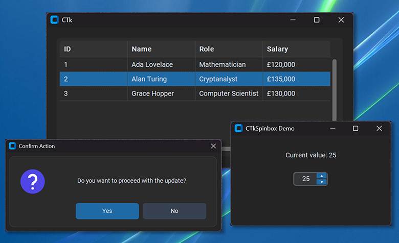

# CTkForge

Custom extension widgets for [CustomTkinter](https://github.com/TomSchimansky/CustomTkinter): high-performance data table, popups / messageboxes, and spinbox.

[](https://pypi.org/project/ctkforge/)
[](https://www.python.org/downloads/)
[](LICENSE)



## Installation

```bash
pip install ctkforge
```

## Components

| Component | Description | Documentation |
| :--- | :--- | :--- |
| [**CTkTable**](docs/table.md) | High-performance data table with smart sorting, row/cell selection, cell editing, and clipboard support. | [API Reference](docs/table.md) • [User Guide](docs/table_user_guide.md) |
| [**CTkPopup**](docs/popup.md) | Modern modal dialogs for alerts, confirmations, and errors with auto-scrolling and keyboard shortcuts. | [API Reference](docs/popup.md) • [User Guide](docs/popup_user_guide.md) |
| [**CTkSpinbox**](docs/spinbox.md) | Numeric input widget with classic arrow steppers, mouse wheel control, limits, and custom steps. | [API Reference](docs/spinbox.md) |
| [**Utilities**](docs/utilities.md) | High-DPI screen coordinate unscaling (`unscale`) and PyInstaller asset path resolution (`resource_path`). | [Utilities Reference](docs/utilities.md) |

---

<p align="center">Crafted and maintained by <b>Rafalus</b>. Happy forging!</p>
