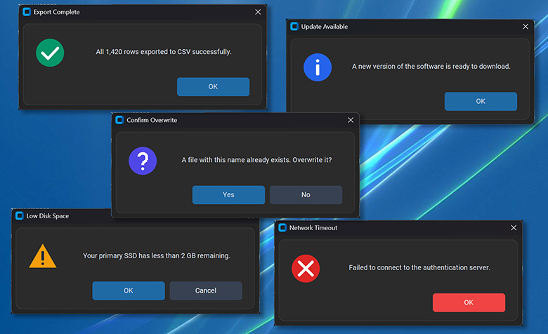

# CTkPopup API Reference

A modern, DPI-aware modal dialog and alert popup for CustomTkinter with semantic button roles, automatic scrolling for long messages, and preset themes.

> For practical recipes and usage walkthroughs, see the [CTkPopup User Guide](popup_user_guide.md).



---

## Table of Contents
1. [Quickstart](#1-quickstart)
2. [Arguments](#2-arguments)
   - [Container & Dimensions](#container--dimensions)
   - [Content & Presets](#content--presets)
   - [Button Configuration](#button-configuration)
   - [Appearance & Typography](#appearance--typography)
   - [Interaction & Lifecycle](#interaction--lifecycle)
3. [Methods](#3-methods)
4. [Class Attributes](#4-class-attributes)

---

## 1. Quickstart

```python
import customtkinter as ctk

from ctkforge import CTkPopup

app = ctk.CTk()
app.geometry("400x240")
app.title("CTkPopup Demo")


def show_confirm() -> None:
    popup = CTkPopup(
        master=app,
        title="Confirm Deletion",
        text="Are you sure you want to delete this record? This action cannot be undone.",
        preset="warning",
        buttons=[
            {"text": "Delete", "value": "delete", "role": "destructive"},
            {"text": "Cancel", "value": "cancel", "role": "cancel"},
        ],
    )
    choice = popup.get()
    print(f"User choice: {choice}")


btn = ctk.CTkButton(app, text="Delete Item", command=show_confirm)
btn.pack(expand=True)

app.mainloop()
```

---

## 2. Arguments

### Container & Dimensions

| Parameter | Type | Default | Description |
| :--- | :--- | :--- | :--- |
| `master` | `Any` | `None` | Parent window or frame (e.g. `ctk.CTk` or `ctk.CTkToplevel`). If `None`, centers directly on the user's primary monitor. |
| `width` | `int` | `478` | Minimum width of the popup window in logical pixels. |
| `height` | `int \| None` | `None` | Optional explicit fixed height in logical pixels. Defaults to natural content height. |
| `wraplength` | `int` | `340` | Text width in logical pixels before auto-wrapping lines. |
| `max_label_height` | `int` | `300` | Height threshold in logical pixels. Messages exceeding this switch to a copyable `CTkTextbox`. |

### Content & Presets

| Parameter | Type | Default | Description |
| :--- | :--- | :--- | :--- |
| `title` | `str \| None` | `None` | Window title bar text. If omitted, uses the preset title (e.g. `"Warning"` or `"Confirm"`), or `"Alert"`. |
| `text` | `str` | `""` | The primary prompt or message to display. Also accepts `message` as an alias. |
| `icon` | `ctk.CTkImage \| str \| Path \| None` | `None` | Stock icon name (`"info"`, `"warning"`, `"error"`, `"question"`, `"success"`), custom image file path, or pre-configured `ctk.CTkImage`. |
| `preset` | `str \| None` | `None` | Preset template name (`"info"`, `"warning"`, `"error"`, `"question"`, `"success"`). Preconfigures stock icon, default title, semantic button roles, and Enter/Escape keybindings. |

### Button Configuration

| Parameter | Type | Default | Description |
| :--- | :--- | :--- | :--- |
| `buttons` | `list \| None` | `None` | Custom button definitions. Accepts strings (`["OK"]`), tuples (`[("Yes", True, "primary")]`), or dicts (`[{"text": "Proceed", "role": "primary"}]`). If omitted, uses preset buttons. |
| `default_button` | `Any` | Auto | Value returned when pressing `<Return>` (Enter). Defaults to the primary button value. |
| `cancel_button` | `Any` | Auto | Value returned when pressing `<Escape>` or the window close (`X`) button. Defaults to cancel button value. |

#### Button Dictionary Specification

When configuring buttons via full dictionaries (`buttons=[{...}]`), the following keys are supported:

| Key | Type | Default | Description | Sample |
| :--- | :--- | :--- | :--- | :--- |
| `text` | `str` | `"OK"` | Label text displayed on the button surface. | `"text": "Proceed"` |
| `value` | `Any` | Same as `text` | Semantic value returned by `popup.get()` when clicked. | `"value": "proceed"` |
| `role` | `str` | `"normal"` | Semantic styling role (`"primary"`, `"cancel"`, `"destructive"`, `"normal"`). | `"role": "primary"` |
| `fg_color` | `str \| tuple` | Role default | Optional custom button surface color (hex string or `(light, dark)` theme tuple). | `"fg_color": "#2FA572"` |
| `hover_color` | `str \| tuple` | Role default | Optional custom mouse-hover color. | `"hover_color": "#107C41"` |
| `text_color` | `str \| tuple` | Role default | Optional custom button text color. | `"text_color": "#FFFFFF"` |

### Appearance & Typography

| Parameter | Type | Default | Description |
| :--- | :--- | :--- | :--- |
| `corner_radius` | `int` | `12` | Corner roundness of the popup border frame in logical pixels. |
| `border_width` | `int` | `1` | Outline border thickness of the popup frame in logical pixels. |
| `border_color` | `str \| tuple[str, str]` | `("gray80", "gray25")` | Outline border color of the popup frame (single hex or `(light, dark)` theme tuple). |
| `fg_color` | `str \| tuple[str, str] \| None` | `None` | Frame background fill color (hex string or `(light, dark)` theme tuple). |
| `text_color` | `str \| tuple[str, str] \| None` | `None` | Message text color (hex string or `(light, dark)` theme tuple). |
| `font` | `tuple[str, int] \| ctk.CTkFont \| None` | `None` | Optional custom font for body text. Defaults to size 13. Messages exceeding `max_label_height` automatically render tracebacks in Consolas. |

### Interaction & Lifecycle

| Parameter | Type | Default | Description |
| :--- | :--- | :--- | :--- |
| `callback` | `Callable[[Any], None] \| None` | `None` | Optional non-blocking callback executed with user choice upon dialog dismissal: `callback(result)`. Runs asynchronously without blocking the calling thread. |
| `sound` | `bool` | `False` | When `True`, plays operating system alert bell upon appearing. |

---

## 3. Methods

All options can be updated dynamically via `.configure()` and queried via `.cget()`.

### Configuration & Inspection

#### `.configure(**kwargs) -> None`
Dynamically updates popup options (`text`, `title`, `preset`, `icon`, `buttons`, colors, dimensions). 
```python
popup.configure(text="Operation succeeded!", preset="success", border_color="#10B981")
```

#### `.cget(attribute_name: str) -> Any`
Reads any active popup configuration option (`"text"`, `"title"`, `"icon"`, `"preset"`, `"buttons"`, `"width"`, `"height"`, `"border_width"`, etc.).
```python
current_text = popup.cget("text")
current_preset = popup.cget("preset")
```

---

### Dialog Lifecycle & Retrieval

#### `.get() -> Any`
Synchronously pauses execution modally until the user makes a choice or dismisses the window, releases the window grab, destroys the dialog cleanly, and returns the selected value.
```python
choice = popup.get()
```

---

## 4. Class Attributes

Master templates and role palettes are exposed directly on the class for app-wide localization or theme overrides:

```python
# Standard preset templates (title, icon, buttons, keyboard defaults):
presets = CTkPopup.PRESETS

# Semantic button role color palettes ('primary', 'destructive', 'cancel', 'normal'):
role_colors = CTkPopup.ROLE_COLORS
```
