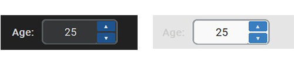

# CTkSpinbox API Reference & Documentation

A compact, modern numeric entry widget for CustomTkinter featuring stacked vertical stepper buttons, keyboard navigation, and mouse wheel scrolling.



---

## Table of Contents
1. [Quick Import & Initialization](#1-quick-import--initialization)
2. [Arguments (`__init__`)](#2-arguments-__init__)
   - [Widget Dimensions](#widget-dimensions)
   - [Numeric Range & Stepping](#numeric-range--stepping)
   - [Appearance & Theming](#appearance--theming)
   - [Interaction & State](#interaction--state)
3. [Methods](#3-methods)
4. [Read-Only Properties](#4-read-only-properties)

---

## 1. Quick Import & Initialization

```python
import customtkinter as ctk

from ctkforge import CTkSpinbox

app = ctk.CTk()
app.geometry("360x200")
app.title("CTkSpinbox Demo")

status_label = ctk.CTkLabel(app, text="Current value: 25", font=("Arial", 14))
status_label.pack(pady=(30, 15))


def on_value_change(value: int) -> None:
    status_label.configure(text=f"Current value: {value}")


spinbox = CTkSpinbox(
    master=app,
    width=100,
    height=32,
    start_value=25,
    min_value=0,
    max_value=100,
    step=5,
    command=on_value_change,
)
spinbox.pack(pady=10)

app.mainloop()
```

---

## 2. Arguments (`__init__`)

### Widget Dimensions

| Parameter | Type | Default | Description |
| :--- | :--- | :--- | :--- |
| `master` | `Any` | *(required)* | Parent container widget or window (e.g. `CTk`, `CTkFrame`, `CTkTabview`). |
| `width` | `int` | `70` | Preferred widget width in logical pixels. |
| `height` | `int` | `28` | Preferred widget height in logical pixels. Stepper micro-buttons scale proportionally to this value. |

### Numeric Range & Stepping

| Parameter | Type | Default | Description |
| :--- | :--- | :--- | :--- |
| `start_value` | `int` | `0` | Initial integer value displayed on instantiation, automatically clamped within `[min_value, max_value]`. |
| `min_value` | `int` | `0` | Minimum allowed integer bound. Lower attempts are clamped to this value. |
| `max_value` | `int` | `100` | Maximum allowed integer bound. Higher attempts are clamped to this value. |
| `step` | `int` | `5` | Delta added or subtracted on each tick or arrow navigation. Enforced to a minimum of `1`. |

### Appearance & Theming

| Parameter | Type | Default | Description |
| :--- | :--- | :--- | :--- |
| `corner_radius` | `int \| None` | `None` | Outer frame corner radius in logical pixels. Defaults to theme entry radius (`theme["CTkEntry"]["corner_radius"]`). |
| `border_width` | `int \| None` | `None` | Outer container border line thickness. Defaults to theme entry border width (`theme["CTkEntry"]["border_width"]`). |
| `fg_color` | `str \| tuple[str, str] \| None` | `None` | Container background fill color. Defaults to theme entry color (`theme["CTkEntry"]["fg_color"]`). |
| `border_color` | `str \| tuple[str, str] \| None` | `None` | Border line color for the container. Defaults to theme entry border color (`theme["CTkEntry"]["border_color"]`). |
| `font` | `tuple[str, int] \| CTkFont \| None` | `None` | Font used for the numeric text entry field. Defaults to `CTkFont(size=13)`. |
| `text_color` | `str \| tuple[str, str] \| None` | `None` | Color for the numeric text. Defaults to theme entry text color (`theme["CTkEntry"]["text_color"]`). |
| `button_color` | `str \| tuple[str, str] \| None` | `None` | Background fill color for stepper buttons (`▲` and `▼`). Defaults to theme button color (`theme["CTkButton"]["fg_color"]`). |
| `button_hover_color` | `str \| tuple[str, str] \| None` | `None` | Background fill color when hovering over stepper buttons. Defaults to theme button hover color (`theme["CTkButton"]["hover_color"]`). |

### Interaction & State

| Parameter | Type | Default | Description |
| :--- | :--- | :--- | :--- |
| `state` | `str` | `"normal"` | Interaction state: `"normal"` or `"disabled"`. When disabled, both text entry and stepper buttons are locked. |
| `justify` | `str` | `"center"` | Horizontal text alignment inside the entry field (`"left"`, `"center"`, or `"right"`). |
| `command` | `Callable[[int], None] \| None` | `None` | Callback executed whenever the numeric value changes: `def on_change(value: int): ...` |

---

## 3. Methods

All options can be updated dynamically via `.configure()` and queried via `.cget()`.

### `.configure(**kwargs) -> None`
Configures widget options dynamically at runtime and refreshes the widget.
```python
# Update bounds, step size, and colors at runtime:
spinbox.configure(
    min_value=10,
    max_value=200,
    step=10,
    state="normal",
    button_color=("#3B8ED0", "#1F6AA5"),
)
```

### `.cget(attribute_name: str) -> Any`
Reads the current value of any widget configuration option.
```python
current_min = spinbox.cget("min_value")
current_max = spinbox.cget("max_value")
current_step = spinbox.cget("step")
current_state = spinbox.cget("state")
```

### `.get() -> int`
Returns the current numeric value as an integer.
```python
current_val = spinbox.get()
```

### `.set(value: int) -> None`
Sets the numeric value, automatically clamping it within `[min_value, max_value]`. Updates the inner entry text and triggers the `command` callback if defined.
```python
# Set value directly (will clamp to limits):
spinbox.set(50)
```

### `.focus() -> None`
Directs keyboard focus into the internal text entry field.
```python
spinbox.focus()
```

---

## 4. Read-Only Properties

```python
val_entry = spinbox.entry
```
