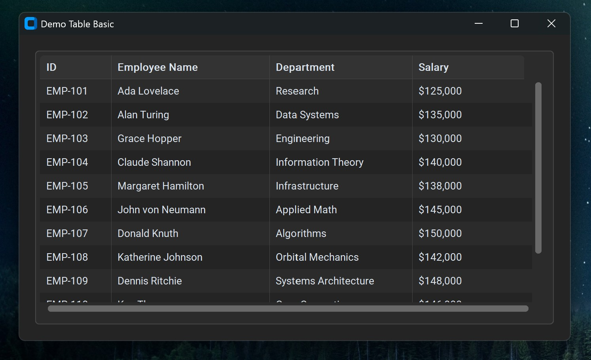

# CTkTable API Reference & Documentation

A fast, modern data table widget for CustomTkinter with built-in sorting, selection, and in-place cell editing.

> For practical recipes and usage walkthroughs, see the [CTkTable User Guide](table_user_guide.md).




---

## Table of Contents
1. [Quick Import & Initialization](#1-quick-import--initialization)
2. [Arguments](#2-arguments)
   - [Widget Frame & Layout](#widget-frame--layout)
   - [Column Headers](#column-headers)
   - [Dataset, Rows & Columns](#dataset-rows--columns)
   - [Selection & Interaction](#selection--interaction)
   - [In-Place Cell Editing](#in-place-cell-editing)
3. [Methods](#3-methods)
   - [Configuration & Inspection (`.configure`, `.cget`)](#configuration--inspection)
   - [Data & Row Operations](#data--row-operations)
   - [Selection Management](#selection-management)
   - [Sorting](#sorting)
   - [Viewport & Navigation](#viewport--navigation)
   - [In-Place Cell Editing](#in-place-cell-editing)
   - [Clipboard & Shortcuts](#clipboard--shortcuts)
   - [Event Binding (`.bind`)](#event-binding)
4. [Read-Only Properties](#4-read-only-properties)

---

## 1. Quick Import & Initialization

```python
import customtkinter as ctk

from ctkforge import CTkTable

app = ctk.CTk()

table = CTkTable(
    app,
    headers=["ID", "Name", "Role", "Salary"],
    values=[
        [1, "Ada Lovelace", "Mathematician", "$120,000"],
        [2, "Alan Turing", "Cryptanalyst", "$135,000"],
        [3, "Grace Hopper", "Computer Scientist", "$130,000"],
    ],
    selection_mode="extended",
    editable=True,
)
table.pack(fill="both", expand=True, padx=20, pady=20)

app.mainloop()
```

---

## 2. Arguments

### Widget Frame & Layout

| Parameter | Type | Default | Description |
| :--- | :--- | :--- | :--- |
| `master` | `Any` | *(required)* | Parent container widget or window (e.g. `CTk`, `CTkFrame`, `CTkTabview`). |
| `width` | `int` | `600` | Preferred widget width in logical pixels. |
| `height` | `int` | `400` | Preferred widget height in logical pixels. |
| `corner_radius` | `int \| None` | `None` | Rounds the outer frame and the top corners of the header. Defaults to theme frame radius. |
| `border_width` | `int \| None` | `None` | Outer table border line thickness. Defaults to theme frame border width. |
| `border_spacing` | `int` | `5` | Inner padding between the table border and the cells. |
| `fg_color` | `str \| tuple \| None` | `None` | Background color for the table container. Defaults to theme frame color. |
| `border_color` | `str \| tuple \| None` | `None` | Border color for the table container. Defaults to theme frame border color. |

### Column Headers

| Parameter | Type | Default | Description |
| :--- | :--- | :--- | :--- |
| `headers` | `list[str] \| None` | `None` | List of column header titles. When `None`, the top header bar is omitted. |
| `header_height` | `int` | `32` | Height of the top pinned header in logical pixels (minimum 20). |
| `header_fg_color` | `str \| tuple \| None` | `None` | Background fill color for the pinned column header bar. Defaults to theme top frame color (`theme["CTkFrame"]["top_fg_color"]`). |
| `header_text_color` | `str \| tuple \| None` | `None` | Text color for column header titles. Defaults to theme label text color. |
| `header_font` | `tuple \| CTkFont \| None` | `None` | Font for column headers. Defaults to active theme bold font (`CTkFont(weight="bold")`). |
| `header_sortable` | `bool` | `True` | Global toggle for interactive column header click sorting. When `False`, programmatic sorting via `.sort_by()` still works. |
| `header_sortable_exclude` | `list[int] \| None` | `None` | List of column numbers excluded from the `header_sortable` base rule. If `header_sortable=True`, excludes are disabled. If `header_sortable=False`, excludes are enabled. |

### Dataset, Rows & Columns

| Parameter | Type | Default | Description |
| :--- | :--- | :--- | :--- |
| `values` | `list[list[Any]] \| None` | `None` | 2D list of row records representing the dataset. |
| `column_widths` | `list[int] \| dict[int, int] \| None` | `None` | Widths in pixels for each column. When `None`, columns share available width equally. |
| `column_types` | `list[str] \| dict[int, str] \| None` | `None` | Data types for sorting (`"str"`, `"int"`, `"float"`, `"date"`). Defaults to case-insensitive `"str"` sorting. |
| `column_sort_keys` | `dict[int, Callable] \| None` | `None` | Custom transformation functions for sorting, e.g. `{3: parse_currency}`. |
| `text_color` | `str \| tuple \| None` | `None` | Default cell text color. Defaults to theme label text color. |
| `font` | `tuple \| CTkFont \| None` | `None` | Font for table body cells. Defaults to active theme font (`CTkFont()`). |
| `row_height` | `int` | `28` | Height of each body row in logical pixels (minimum 16). |
| `row_color` | `str \| tuple \| None` | `None` | Base row background color. Defaults to container `fg_color` (uniform flat look). |
| `alternate_row_color` | `str \| tuple \| None` | `None` | Odd row background color for opt-in zebra striping. Defaults to `None` (matches `row_color`, no striping). |

### Selection & Interaction

| Parameter | Type | Default | Description |
| :--- | :--- | :--- | :--- |
| `selection_target` | `str` | `"row"` | What gets highlighted on click: `"row"` (entire line) or `"cell"` (individual box). |
| `selection_mode` | `str` | `"single"` | Selection behavior: `"single"` (one item), `"extended"` (Shift/Ctrl range & multi-select), or `"none"` (disabled). |
| `selected_color` | `str \| tuple \| None` | `None` | Highlight fill color for selected items. Defaults to active theme button color. |
| `selected_text_color` | `str \| tuple \| None` | `None` | Text color for selected items. Defaults to active theme button text color. |
| `command` | `Callable \| None` | `None` | Callback fired whenever selection changes: `def on_select(items): ...` |
| `copyable` | `bool` | `False` | Master toggle for interactive `Ctrl+C` clipboard copying. Disabled by default. |

### In-Place Cell Editing

| Parameter | Type | Default | Description |
| :--- | :--- | :--- | :--- |
| `editable` | `bool` | `False` | Master toggle for in-place cell editing. Disabled by default. |
| `editable_columns_exclude` | `list[int] \| None` | `None` | List of column numbers excluded from the `editable` base rule. If `editable=True`, excludes are locked. If `editable=False`, excludes are editable. |
| `on_cell_edit` | `Callable \| None` | `None` | Callback fired on edit commit: `def on_edit(actual_row, col, old_val, new_val): ...` |


---

## 3. Methods

All options can be updated dynamically via `.configure()` and queried via `.cget()`.

### Configuration & Inspection

#### `.configure(**kwargs) -> None`
Configures widget options dynamically and refreshes the canvas in a single batched pass.
```python
# Update dataset, layout, and styling at runtime:
table.configure(
    values=[["Alice", 28], ["Bob", 34]],
    row_height=32,
    row_color=("#f9f9f9", "#1f1f1f"),
    alternate_row_color=("#f0f0f0", "#262626"),
    selection_mode="single",
)
```

#### `.cget(attribute_name: str) -> Any`
Reads the current value of any widget configuration option.
```python
current_height = table.cget("row_height")
current_values = table.cget("values")
row_bg = table.cget("row_color")
```

---

### Data & Row Operations

#### `.get(row: int | None = None, column: int | None = None) -> Any`
Returns table data in the current visual display order (respecting active sorting):
- If `row=None` and `column=None`: returns the complete 2D list of all rows in current visual order (ideal for exports).
- If `row` is specified and `column=None`: returns that single row (equivalent to `.get_row(row)`).
- If `row` and `column` are both specified: returns that single cell value (equivalent to `.get_cell(row, col)`).
- If `row=None` and `column` is specified: returns a list of all values in that column.
```python
# Export the entire dataset in current visual sorted order:
visible_data = table.get()

# Get specific visual row or cell:
top_row = table.get(row=0)
first_name = table.get(0, 1)
```

#### `.insert_row(index: int | None = None, values: list[Any] | None = None) -> int`
Inserts a new record into the dataset.
- If `index=None`: appends the row to the dataset (respecting any active column sort).
- If `index` is specified: automatically bakes any active sort into the baseline (`commit_sort()`) and inserts the record directly at that visual row position so it stays in place.
- Returns the new display index.
```python
# Append to end (or sorted slot if sorted):
new_idx = table.insert_row(values=[4, "John von Neumann", "Polymath", "$150,000"])

# Insert at specific visual position (freezes sort):
top_idx = table.insert_row(index=0, values=[5, "Grace Hopper", "Scientist", "$160,000"])
```

#### `.delete_rows(row_indexes: list[int] | set[int] | int) -> None`
Deletes one or multiple rows in a single batch. Updates internal sort maps, clamps scroll positions, and cleans up selection sets.
```python
table.delete_rows(2)  # Delete single row
table.delete_rows([0, 1, 3])  # Delete multiple rows in one operation
```

#### `.update_cell(row_index: int, col_index: int, value: Any, notify: bool = True) -> None`
Updates a cell value in-place. If the table is actively sorted by `col_index`, the sort order is refreshed automatically.
```python
table.update_cell(0, 3, "$140,000")
```

#### `.update_row(display_row: int, values: list[Any], notify: bool = True) -> None`
Atomically updates an entire row record in-place. If the table is actively sorted by one of the modified columns, the sort order refreshes automatically.
```python
table.update_row(0, [1, "Ada Lovelace", "Mathematician", "$150,000"])
```

#### `.get_raw_row_index(display_row: int | Sequence[int]) -> int | list[int]`
Translates one or multiple visual display row indexes to raw storage indexes.
```python
# Pass a single visual row index:
raw_row_index = table.get_raw_row_index(disp_row_index)  # e.g. disp_row_index = 5 --> raw_row_index = 42

# Or pass a list of visual row indexes:
selected_rows = table.get_selected_rows()  # e.g. [5, 12]
raw_row_indexes = table.get_raw_row_index(selected_rows)  # e.g. [42, 105]
```

#### `.get_display_row_index(raw_row: int | Sequence[int]) -> int | list[int]`
Translates one or multiple raw storage indexes to current visual display row indexes.
```python
# Pass a single raw row index:
disp_row_index = table.get_display_row_index(raw_row_index)
table.select_row(disp_row_index)
table.scroll_to(row=disp_row_index)

# Or translate multiple raw row indexes at once:
disp_row_indexes = table.get_display_row_index([42, 105])  # e.g. [0, 2]
```

#### `.get_row(row_index: int) -> list[Any]`
Returns a copy of the row record at the specified display index.
```python
record = table.get_row(0)  # e.g. [1, "Ada Lovelace", "Mathematician", "$120,000"]
```

#### `.get_cell(row_index: int, col_index: int) -> Any`
Returns the single cell value at display position `(row_index, col_index)`.
```python
name = table.get_cell(0, 1)  # "Ada Lovelace"
```

---

### Selection Management

#### `.get_selected_rows() -> list[int]`
Returns a sorted list of selected display row indexes.
- In row selection mode: returns all selected rows.
- In cell selection mode: returns the deduplicated rows containing any selected cells.
```python
selected_rows = table.get_selected_rows()  # e.g. [0, 2]
```

#### `.get_selected_cells() -> list[tuple[int, int]]`
Returns a sorted list of selected `(row, col)` cell coordinates.
- In cell selection mode: returns all explicitly selected cells.
- In row selection mode: returns all cell coordinates across the selected rows.
```python
selected_cells = table.get_selected_cells()  # e.g. [(0, 1), (0, 2)]
```

#### `.select_row(row_index: int, notify: bool = True) -> None`
Selects a specific row by its display index.
```python
table.select_row(0)
```

#### `.deselect_row(row_index: int, notify: bool = True) -> None`
Removes a specific row from the selection set.
```python
table.deselect_row(0)
```

#### `.select_cell(row_index: int, col_index: int, notify: bool = True) -> None`
Selects an individual cell at `(row_index, col_index)`.
```python
table.select_cell(2, 3)
```

#### `.select_all(notify: bool = True) -> None`
Selects all rows (or all cells) across the entire table.
```python
table.select_all()
```

#### `.clear_selection(notify: bool = True) -> None`
Deselects all rows and cells.
```python
table.clear_selection()
```

---

### Sorting

#### `.sort_by(column_index: int, ascending: bool = True) -> None`
Sorts the table by the specified column using zero-reshuffle index mapping. Raw data is never moved.
```python
table.sort_by(0, ascending=True)  # Sort column 0 ascending (A-Z)
table.sort_by(2, ascending=False)  # Sort column 2 descending (Z-A)
```

#### `.clear_sort() -> None`
Resets the table back to its baseline insertion order (as long as a sort was not permanently baked with `.commit_sort()`).
```python
table.clear_sort()
```

#### `.commit_sort() -> None`
Permanently bakes the current visual sorted order into the underlying raw dataset and resets the active sort state. Header sort arrows (▲ / ▼) are cleared, and this order becomes the new baseline dataset.
```python
table.sort_by(1, ascending=True)  # Sort by column 1
table.commit_sort()  # Lock this sorted order into raw data
print(table.cget("values"))  # Baseline data is now permanently sorted
```

#### `.get_sort_state() -> tuple[int | None, bool]`
Returns the currently sorted column index and direction: `(col_index, is_ascending)`.
```python
col, is_asc = table.get_sort_state()
print(f"Sorted on col {col}, Ascending: {is_asc}")
```

---

### Viewport & Navigation

#### `.scroll_to(row: int | None = None, col: int | None = None) -> None`
Scrolls the table viewport to bring the specified display row or column into view.
```python
table.scroll_to(row=1500)  # Scroll vertically to row 1500
table.scroll_to(row=0, col=5)  # Jump to top row, column 5
```

#### `.auto_fit_column(col_index: int) -> None`
Measures the text of all rows and the header title for the given column using font metrics, and adjusts the column width to fit content with padding.
```python
table.auto_fit_column(1)  # Fit column 1 to longest text
```

#### `.auto_fit_columns(columns: list[int] | None = None) -> None`
Measures and fits column widths for all columns (or a specified list of column indexes) in a single batched pass with one redraw cycle.
```python
table.auto_fit_columns()  # Fit all columns to content on load
table.auto_fit_columns([0, 1, 3])  # Fit specific subset of columns
```

---

### In-Place Cell Editing

#### `.start_editing(row: int, col: int) -> None`
Programmatically mounts the floating `CTkEntry` editor over the target cell.
```python
table.start_editing(0, 1)  # Open editor on row 0, col 1
```

#### `.edit_focused_cell() -> None`
Opens the editor on the cell that currently has keyboard focus.
```python
table.edit_focused_cell()
```

---

### Clipboard & Shortcuts

#### `.copy_selection() -> str`
Copies currently highlighted rows or cells to the system clipboard as Tab-Separated Values (TSV) with newlines and returns the string. Pastes directly into Excel or text editors.
```python
tsv_text = table.copy_selection()
```

---

### Event Binding

#### `.bind(sequence: str | None = None, command: Callable | None = None, add: bool = True) -> None`
Registers a keyboard or mouse shortcut. Events are automatically forwarded to the internal canvas so hotkeys work when the table has keyboard focus.
```python
# Bind custom shortcut to table:
table.bind("<F2>", lambda _e: table.edit_focused_cell())
```

---

## 4. Read-Only Properties

```python
is_editing = table.is_editing
```
